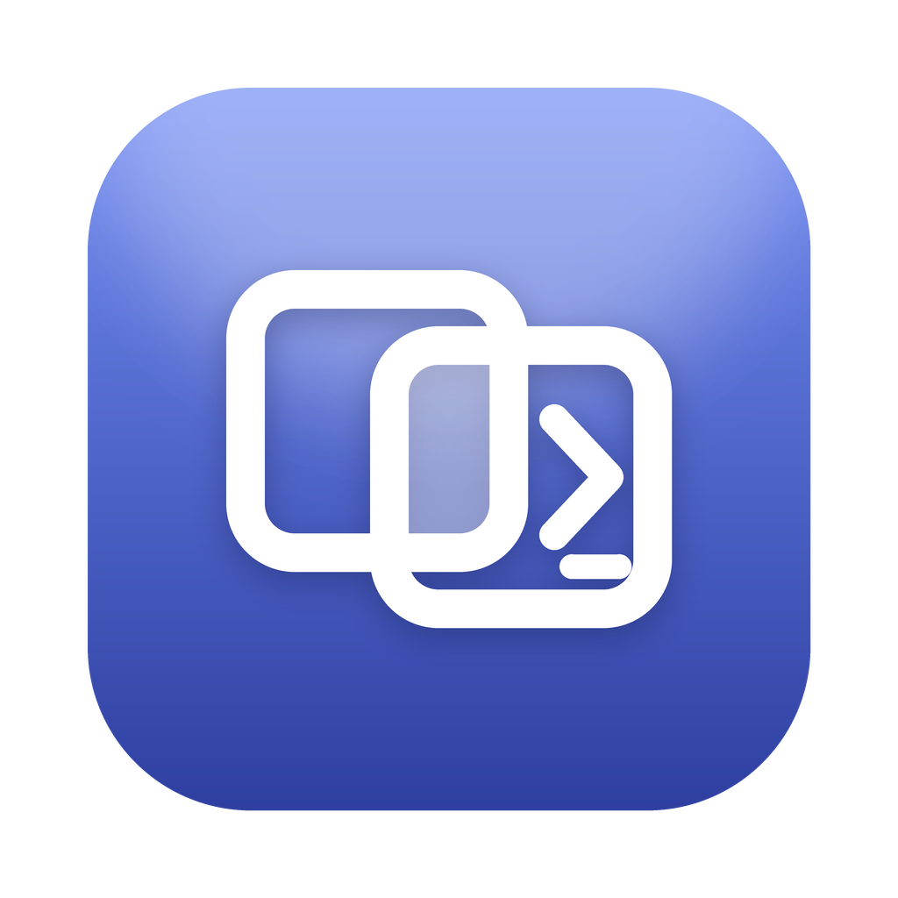

<p align="center">
  
</p>

<h1 align="center">Claude Companion</h1>

<p align="center">
  One place to control <b>Claude Desktop</b> and <b>Claude Code</b> (the terminal program): a
  desktop app and a command-line tool that keep your sessions identical across all your accounts,
  share MCP servers between the two, and start or continue either, on Windows, macOS and Linux.<br>
  Sign out, sign in with another account, and everything is still there.
</p>

> **Status: first release of a fork.** Claude Companion is a hard fork of
> [cc-same](https://github.com/songkeys/cc-same) by Songkeys, with the goals listed under
> [Roadmap](#roadmap). The features are written and tested against stand-in data; what has not yet
> been run on real systems is listed plainly under *Still needs real-world testing*.

## Why

Claude Desktop keeps a separate list of local Code sessions for every account and organization.
Switch accounts and the sidebar is empty, even though every conversation is still on disk in
`~/.claude/projects`. Claude Companion keeps every account's list in step: sessions, titles,
archive state, deletions, scheduled tasks and task suggestions.

It comes as a desktop app and a command-line tool that share one engine.

## What works today

Inherited from cc-same 0.1.12 (see [NOTICE.md](NOTICE.md)):

- Sync of local Code sessions, deletions, scheduled tasks and task suggestions across accounts,
  with snapshots, a 30-day trash, and atomic writes. Syncing needs no network access.
- Background sync from login, with a tray / menu bar icon.
- A numbered account list with aliases and plan usage, and **account switching on macOS**.
- **New in this fork:** account switching on **Windows and Linux** (including ending Claude from
  the app or with `--force` where Windows keeps it in the tray). It is tested against stand-in
  data and compiles on all three systems, but it has not yet been run against a real Claude
  Desktop on Windows or Linux.
- **New in this fork:** lost-chat rescue, Markdown/HTML export, token statistics and diagnostics,
  in the app (Settings › Tools) and on the command line; copying chats between accounts on the
  command line. The app's new screens have not yet been checked by eye on every system.
- **New in this fork:** one set of **sidebar groups** for every account (off until you turn it on:
  `claude-companion config --groups on`, or Settings › Sync), re-implemented from
  claude-desktop-session-sync. It runs only while Claude is closed, backs up Claude's Local Storage
  first, and has been tested against stand-in databases only, never against a real Claude profile.
  See [how it works](docs/how-it-works.md#sidebar-groups).
- **New in this fork: control both Claude Desktop and Claude Code.** `claude-companion code …`
  shows where Claude Code is and who it is signed in as, lists its terminal sessions, continues one
  in the folder it worked in (here or in a new terminal window), starts it anywhere, and reads or
  changes its user settings (secrets are hidden when shown; every change keeps the old file).
  `mcp list` / `mcp share` put the MCP servers of Desktop and Claude Code side by side and copy what
  one lacks into the other. `open desktop|code` and `quit` start and stop the two. `doctor` reports
  on both. In the app these are in Settings › Tools (*Claude Desktop*, *Claude Code (terminal)*,
  *Share MCP servers*); quitting Claude from the app happens when you switch accounts, and the
  command line's `quit` has no button of its own. **Claude Code's own sign-in can be switched** on
  Windows and Linux (`code login save | list | use | forget`, and *Claude Code sign-in* in
  Settings › Tools): sign in with `/login` in `claude`, save it, and switch between saved accounts.
  Not available on macOS, where the sign-in is in the Keychain.
- Ten interface languages, light and dark themes, and update checks against this repository's
  releases.

## Roadmap

Everything below that can be done without other people's computers is done. What is left needs
real machines and real accounts, and is listed at the end.

1. **GUI and CLI parity.** Done. Every command has an app control and the other way round, apart
   from the differences in [the table below](#the-app-and-the-command-line-side-by-side).
2. **Windows, macOS and Linux.** Written for all three and compile-checked for all three
   (the engine and command line tests run on Linux in a container; for macOS they are compile-checked
   only; the app is built by the release workflow on each). Real Claude setups have only been used
   on Windows, on copies (see *Still needs real-world testing*).
3. **Rename and relicense.** Done: the project is Claude Companion, `AGPL-3.0-or-later`.
4. **Features from two sibling projects**, re-implemented in Rust and credited. Done:
   - [claude-desktop-session-sync](https://github.com/RasmusKD/claude-desktop-session-sync):
     sidebar groups (opt-in, see above). Its three-way scheduled-task merging, deletion
     stash and backups were already in cc-same (tasks merged three ways, a 30-day trash,
     snapshots), and its account freezing is what `config --exclude` / the account list's
     include switch do here, so nothing else is missing.
   - [claude-switcher](https://github.com/nyxon-tech/claude-switcher): recover lost chats, copy
     chats between accounts, token statistics, export, switching logins on every system, and a
     doctor check, on the command line and in the app. Undo uses sync's snapshots (`restore`)
     instead of a journal, and there is no *move*, which sync's deletions would turn into
     deleting the chat everywhere.
5. **Beyond the original list.** Control of Claude Code (the terminal program) next to Claude
   Desktop: sessions, resume, settings, its own sign-in switching (not on macOS), MCP servers shared
   between the two, and starting and quitting either.
6. **Credits kept honest**: see [NOTICE.md](NOTICE.md).

### Still needs real-world testing

- Account switching on Windows and Linux against a real Claude Desktop (written from
  claude-switcher's research, tested on stand-in data only).
- Sidebar-group sync: a real Claude opening a database this tool wrote.
- Claude Code sign-in switching with a real sign-in.
- The app on macOS and Linux, and everything on macOS. The engine and command-line tests have
  been run on real Linux (a Debian container, as root and as an ordinary user) and pass; nothing has
  been run on a Linux desktop with a real Claude.
- Opening terminal windows on macOS and Linux.
- Artwork: the icon and tray images are new; they have not yet been seen in a real tray, Dock or
  taskbar on each system, and `docs/images/` still holds cc-same's two old screenshots.

## Using the command line

```text
claude-companion doctor         what every account has, and anything that needs attention
claude-companion plan           what a sync would change (dry run)
claude-companion sync           sync once
claude-companion install        sync, then keep syncing in the background from login
claude-companion uninstall      stop background syncing (every account keeps its full copy)
claude-companion status         background sync and the last sync
claude-companion snapshots      list snapshots
claude-companion restore <id>   put every session list back as it was (quit Claude first)
claude-companion retention      how long Claude Code keeps transcripts (--keep, --undo)
claude-companion accounts       your accounts, numbered, with their plan usage (--json)
claude-companion switch [<who>] switch Claude to an account, or the next one (--force on Windows)
claude-companion add            restart Claude signed out, to add an account (--force on Windows)
claude-companion remove <who>   take an account off the list, forgetting its saved sign-in
claude-companion alias <who> <name>, disable <who>, enable <who>, move <who> <number>
claude-companion reset [<who> <day> <time>]  when an account's weekly limit renews (--clear); the account list then counts down to it
claude-companion chats list     every chat of every account (--account, --json)
claude-companion chats lost     conversations on disk that no account shows
claude-companion chats rescue   give lost chats a card again (--to <account>)
claude-companion chats copy     put chats into another account's list (--from, --to)
claude-companion chats export   a chat as Markdown or a web page (--format md|html)
claude-companion stats          tokens by model, day and folder, from local transcripts
claude-companion groups         merge the sidebar groups of all accounts (--dry-run, --json)
claude-companion code status    where Claude Code is, who it is signed in as, what it has (--json)
claude-companion code sessions  terminal sessions, newest first (--dir, -n, --terminal-only, --json)
claude-companion code resume <id|latest>   continue a session in its folder (--new-window)
claude-companion code run [dir] [-- args]  start Claude Code here, or in a new window
claude-companion code login save|list|use <who>|forget <who>   switch Claude Code's own account
claude-companion code settings [key [value]]   show (secrets hidden) or change a user setting (--unset)
claude-companion mcp list       MCP servers of Claude Desktop and Claude Code side by side
claude-companion mcp share      copy servers one lacks into the other (--to, --overwrite, --dry-run)
claude-companion open desktop   start Claude Desktop; `open code [dir]` opens a terminal with Claude Code
claude-companion quit           quit Claude Desktop (--force on Windows)
claude-companion config         --exclude <account-id>, --auto-join off, --groups on, …
```

The first time a sync copies sessions into the account Claude has open, quit and reopen Claude
once: it only reads its session list at startup.

### The app and the command line side by side

Everything is in both, with these differences:

| Command line | In the app |
| --- | --- |
| `doctor`, `plan`, `sync`, `status`, `install` / `uninstall` | The window's headline, *Sync now*, the background switch, Settings › Tools › *Diagnostics* |
| `snapshots`, `restore`, `fix-symlinks`, `retention` | Settings › Snapshots, the fix-links notice, Settings › Transcripts |
| `accounts`, `switch`, `add`, `remove`, `alias`, `enable` / `disable`, `move` | The account list |
| `reset` | The pencil on an account (*Edit…*): its name and weekly reset day and time |
| `chats list`, `chats copy`, `chats lost`, `chats rescue`, `chats export`, `stats` | *All chats* (show, copy between two accounts), *Lost chats*, *Export a chat*, *Token statistics* |
| `groups`, `config --groups` | *Merge sidebar groups*, Settings › Sync |
| `code sessions`, `resume`, `run [dir]`, `status` | *Terminal sessions*, *Claude Code (terminal)* (new, continue, in a folder), *Diagnostics* |
| `code settings` | *Claude Code settings*: show, and the permission mode. **Any other key is command line only.** |
| `code login …` | *Claude Code sign-in* (save, switch, forget) |
| `mcp list`, `mcp share` | *Share MCP servers* (show, preview, share) |
| `open desktop` / `open code`, `quit` | *Claude Desktop* (open, quit), *Claude Code (terminal)* |

Only in the app: the tray icon, light and dark themes, the interface language, opening at login,
and update checks and installs (the command line is updated by installing a newer release). Only on
the command line: `--json` output, `--dry-run`, `chats rescue` / `chats copy` for chosen chats
rather than all, accounts with several organizations in `chats copy`, and any `code settings` key.

## Safety

- Claude Companion only reads and writes inside Claude Desktop's data folder and its own state
  folder. Every location can be redirected with `CLAUDE_COMPANION_USER_DATA`,
  `CLAUDE_COMPANION_STATE_DIR`, `CLAUDE_COMPANION_DESKTOP_LOG_DIR` and `CLAUDE_COMPANION_PROJECTS`,
  which is how the tests (and any dry run you want) avoid your real Claude setup.
- A copy-on-write snapshot of every index is taken before the first change and at most hourly
  afterwards; nothing is deleted without going to a trash folder for 30 days.
- Writes are atomic, never follow symlinks, and never overwrite a file that appeared or changed
  since planning.
- Sidebar groups touch Claude's Local Storage, so they wait until Claude is closed, copy the
  database first, check what they wrote reads back, and put the copy back if it does not.

## Building from source

```bash
cargo build --release                        # CLI (Rust 1.89+)
cargo test                                   # engine + CLI tests
cargo app                                    # run the app
cargo app-test                               # app tests
```

The app lives in `crates/app` as a workspace of its own, so the CLI never pulls in the GUI
framework. Interface text is in [`crates/app/locales/app.yml`](crates/app/locales/app.yml).
Linux needs `clang cmake libfontconfig-dev libssl-dev libvulkan1 libwayland-dev libx11-xcb-dev
libxkbcommon-x11-dev libzstd-dev pkg-config` for the app. [`docs/how-it-works.md`](docs/how-it-works.md)
describes how Claude Desktop's data is laid out and why the sync is safe.

## Contact and support

Claude Companion is free software made in spare time. If it is useful to you:

- **Contact the developer** on SimpleX (private, no account needed):
  [SimpleX contact link](https://smp14.simplex.im/a#3gZ-zeHs4QrFZKLAN0o3SC_XQJXhj1eYBVTO_c0FAtg).
  For bugs and ideas that others can read too, use the
  [issue tracker](https://github.com/slammingprogramming/claude-companion/issues).
- **Donate** in ordinary money through [Ko-fi](https://ko-fi.com/scenprogramming), or in crypto:

| Coin | Address |
| --- | --- |
| Bitcoin (BTC) | `sp1qq2637t6ve9zp4wh0e4ly2u7h7jwfn0k6c4535lxpp3wrqvmkua6xjqkwevyz0wwqx5ly2f0q29qh48wgf9gl0zt049za9kr9m8xgkey4cyggxa0x` (a Silent Payments address: your wallet must support BIP 352) |
| Ethereum (ETH) | `0x8F238db898102125Fd968ed7CaD959Cb594a7e93` |
| Monero (XMR) | `8AYK93mQEzsFFEFkuPN7wC9rPcXCyEXa1Ye5bH9U2GR3PpaZiYc84SxjMcdSdVMaaQUGmCXYkuxdDSG5bM3EVyqR25nbumV` |

The same details are in the app (Settings › About and support, with buttons that copy each
address) and from `claude-companion about`. Donations are voluntary and buy nothing: there is no
paid tier, and the software and its license are the same for everyone. Only trust these details
from this repository or from the app itself.

## License and credits

Copyright (C) 2026 SlammingProgramming and Claude Companion contributors.

Licensed under the [GNU Affero General Public License, version 3 or later](LICENSE). Large parts
derive from MIT-licensed work whose notices are kept in [`LICENSES/`](LICENSES/); who did what is
set out in **[NOTICE.md](NOTICE.md)**:

- [cc-same](https://github.com/songkeys/cc-same) by Songkeys, the base of this fork;
- [claude-desktop-session-sync](https://github.com/RasmusKD/claude-desktop-session-sync) by RasmusKD;
- [claude-switcher](https://github.com/nyxon-tech/claude-switcher) by NeezerGu and Nyxon, and
  [claude-profile-switcher](https://github.com/NeezerGu/claude-profile-switcher) by NeezerGu before it;
- [claude-swap](https://github.com/realiti4/claude-swap) by realiti4, an inspiration.

Claude Companion is not affiliated with or endorsed by Anthropic. Claude is a trademark of Anthropic.
